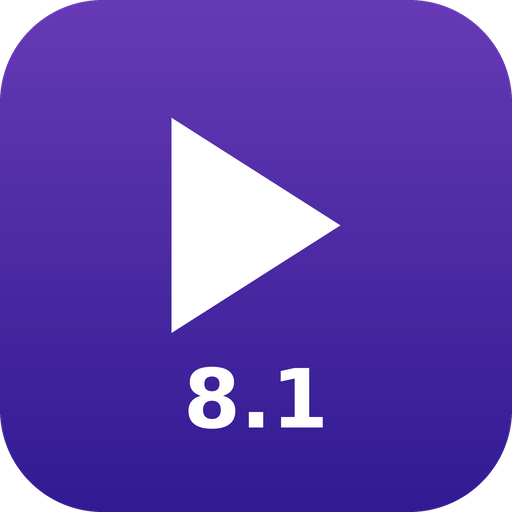

# DV Player for Android

**Dolby Vision profilo 7 → 8.1 in tempo reale per Android** · **Real-time Dolby Vision profile 7 → 8.1 for Android**

[🇮🇹 Italiano](#italiano) · [🇬🇧 English](#english)

DV Player è un fork non ufficiale di [Just (Video) Player](https://github.com/moneytoo/Player) di Marcel Dopita.
DV Player is an unofficial fork of [Just (Video) Player](https://github.com/moneytoo/Player) by Marcel Dopita.

**[⬇️ Scarica l'ultima versione / Download the latest version](../../releases/latest)** · **[❤️ Sostieni il progetto / Support the project](https://paypal.me/imperatore31)**

---

## Italiano

### Il problema
I remux dei Blu-ray UHD (per esempio i file MKV creati con MakeMKV) usano il **Dolby Vision profilo 7** (MEL o FEL). Quasi tutti i telefoni e i tablet Android con Dolby Vision supportano solo il **profilo 8.1**: con questi file danno errore oppure mostrano solo l'HDR10.

### La soluzione
DV Player converte il video **mentre lo riproduce**, senza file temporanei e senza ricodificare:
- scarta lo strato di miglioramento (EL),
- riscrive ogni RPU Dolby Vision come RPU profilo 8.1 (come `dovi_tool -m 2 convert --discard`: il MEL viene convertito senza perdite, il FEL perde lo strato di miglioramento),
- presenta il video al decoder del dispositivo come Dolby Vision 8.1.

Funziona anche con lo streaming: per esempio da **Emby / Jellyfin / Plex** in *Direct Play* (il file MKV originale, senza transcodifica) oppure da **Stremio**, e in generale da qualsiasi app che permetta di aprire i video con un lettore esterno. Il consumo di processore è trascurabile.

In più DV Player usa sempre il **decoder Dolby Vision** per i video Dolby Vision, anche quando il dispositivo dichiara capacità inferiori a quelle reali (per esempio "P8 FHD 30" su un tablet che riproduce senza problemi il 4K). Just Player 0.219 in questi casi riproduce il 4K Dolby Vision in semplice HDR10.

### Installazione
1. Sul dispositivo Android apri la pagina **[Releases](../../releases/latest)** e scarica il file `DVPlayer-….apk`.
2. Apri il file scaricato. Se Android lo chiede, consenti l'installazione di app sconosciute.
3. Gli aggiornamenti si installano allo stesso modo, sopra la versione precedente.

DV Player si installa accanto a Just Player, senza sostituirlo.

### Uso con Emby, Jellyfin, Plex, Stremio e altre app
1. Nelle impostazioni dell'app (Emby, Jellyfin, Plex, Stremio…) scegli di riprodurre i video con un **lettore esterno**. Con Emby, Jellyfin e Plex attiva anche la riproduzione diretta (*Direct Play*), così arriva il file originale senza transcodifica.
2. Quando avvii un film, scegli **DV Player**.

### Impostazioni
Avvia un video, tocca lo schermo e **tieni premuta** l'icona dell'ingranaggio ⚙️ in basso a destra. In fondo all'elenco:
- **Converti Dolby Vision profilo 7 in 8.1**: attiva di default sui dispositivi che supportano il profilo 8 ma non il 7. Sotto è indicato cosa supporta il dispositivo.
- **Diagnostica Dolby Vision**: se attiva, alla prima pausa di un video Dolby Vision mostra il decoder usato, la modalità (Dolby Vision o HDR10) e quanti metadati sono stati convertiti.

### Limiti
- Solo profilo 7 a traccia singola (strato base + miglioramento + RPU nella stessa traccia, come nei remux MakeMKV). I file con lo strato di miglioramento in una traccia separata non sono supportati.
- File e flussi progressivi (MKV, MP4, TS); non HLS/DASH. I contenuti cifrati non vengono convertiti.
- Serve un dispositivo con decoder Dolby Vision profilo 8; altrimenti il video viene riprodotto in HDR10.

Provato su: Lenovo Tab P12 Pro (Snapdragon 870).

### Sostieni il progetto
DV Player è gratuito e senza pubblicità. Se ti è utile, puoi sostenerne lo sviluppo con una donazione libera su PayPal: **[paypal.me/imperatore31](https://paypal.me/imperatore31)**. Grazie!

---

## English

### The problem
UHD Blu-ray remuxes (e.g. MKV files made with MakeMKV) use **Dolby Vision profile 7** (MEL or FEL). Almost all Android phones and tablets with Dolby Vision only support **profile 8.1**: they either fail to play these files or show plain HDR10.

### The solution
DV Player converts the video **while playing it**, with no temporary files and no re-encoding:
- the enhancement layer (EL) is dropped,
- every Dolby Vision RPU is rewritten as a profile 8.1 RPU (like `dovi_tool -m 2 convert --discard`: MEL is converted losslessly, FEL loses its enhancement layer),
- the video is handed to the device decoder as Dolby Vision 8.1.

It also works when streaming, e.g. from **Emby / Jellyfin / Plex** with *Direct Play* (original MKV file, no transcoding) or from **Stremio**, and in general from any app that can open videos in an external player. CPU usage is negligible.

DV Player also always uses the **Dolby Vision decoder** for Dolby Vision videos, even when the device declares lower capabilities than it actually has (e.g. "P8 FHD 30" on a tablet that plays 4K just fine). In that case Just Player 0.219 plays 4K Dolby Vision as plain HDR10.

### Installation
1. On your Android device open the **[Releases](../../releases/latest)** page and download `DVPlayer-….apk`.
2. Open the downloaded file. If Android asks, allow installing unknown apps.
3. Updates are installed the same way, over the previous version.

DV Player installs next to Just Player, it does not replace it.

### Usage with Emby, Jellyfin, Plex, Stremio and other apps
1. In the app settings (Emby, Jellyfin, Plex, Stremio…) choose to play videos with an **external player**. With Emby, Jellyfin and Plex also enable *Direct Play*, so the original file is streamed without transcoding.
2. When you start a movie, pick **DV Player**.

### Settings
Start a video, tap the screen and **long press** the ⚙️ gear icon at the bottom right. At the end of the list:
- **Convert Dolby Vision profile 7 to 8.1**: enabled by default on devices that support profile 8 but not profile 7. The device capabilities are shown below it.
- **Dolby Vision diagnostics**: when enabled, the first pause of a Dolby Vision video shows the decoder in use, the mode (Dolby Vision or HDR10) and how many RPUs were converted.

### Limitations
- Single-track profile 7 only (base layer + enhancement layer + RPU in one track, as in MakeMKV remuxes). Dual-track files are not supported.
- Progressive files/streams (MKV, MP4, TS); not HLS/DASH. Encrypted content is not converted.
- A device with a Dolby Vision profile 8 decoder is required; otherwise the video plays as HDR10.

Tested on: Lenovo Tab P12 Pro (Snapdragon 870).

### Support the project
DV Player is free and ad-free. If you find it useful, you can support its development with a donation of any amount on PayPal: **[paypal.me/imperatore31](https://paypal.me/imperatore31)**. Thank you!

---

## Credits & licenses

- **[Just (Video) Player](https://github.com/moneytoo/Player)** by Marcel Dopita – [Unlicense](LICENSE). DV Player is based on Just Player 0.219; see its page for the full list of player features.
- **[dovi_tool](https://github.com/quietvoid/dovi_tool)** by quietvoid – MIT License. The RPU code in `app/src/main/java/com/brouken/player/dovi/DoviRpu.java` is a Java port of parts of its `dolby_vision` crate and is tested against its reference files (`app/src/test`).
- **[AndroidX Media3](https://github.com/androidx/media)** – Apache License 2.0. FFmpeg audio decoders – LGPL.
- The code added by DV Player is released under the Unlicense, like Just Player, except for the parts derived from dovi_tool (MIT).

Dolby, Dolby Vision and the double-D symbol are trademarks of Dolby Laboratories. DV Player is not affiliated with or endorsed by Dolby Laboratories or by the author of Just Player.
